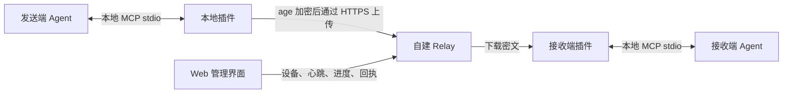

# Agent Handoff

**让另一台设备上的 Agent 接着做：交接任务上下文，也交接实际文件。**

Agent Handoff 包含自建中转服务、Web 管理界面和本地 MCP 插件。发送端整理目标、已有结论、约束、待办与产物，接收端解密、校验后继续工作。当前客户端版本：**0.6.0**（Relay 0.4.0） · [MIT](LICENSE)。

[快速开始](#快速开始) · [交给 Agent 安装](#交给-agent-安装) · [支持的 Agent](#支持的-agent) · [部署中转服务](#部署中转服务) · [文档](#文档)

## 能做什么

- **远端会话库**：本地 Agent 总结并上传，接收端通过 MCP 查看标题、来源与时间，选择会话后继续；上传时无需指定设备。详见 [会话库指南](SESSIONS.md)。
- **定向接力**：发送端说“接力到办公室电脑”，接收端说“接力”；插件自动发现设备与 Agent、查收和校验，多候选时再选择。
- **新交接提醒**：宿主 MCP 连接期间每 10 秒检查，提供系统提醒与 MCP 日志通知，按路由去重。
- **跨设备交接**：把任务说明和工作目录内明确选择的文件发送到指定设备及 Agent 路由。
- **宿主原生入口**：DSH / Hermes 使用 `/relay`，Codex Linux 使用 `$relay`，ChatGPT 桌面提供接力技能及普通聊天安全隧道。
- **端到端文件加密**：发送端使用接收设备的 age 公钥加密；中转只保存密文与投递元数据。
- **持续传输与回执**：分块、断点续传、持久队列，以及校验、接受、开始和完成等状态。
- **Web 管理**：登记设备、下载专用凭证、轮换或撤销令牌，查看 Agent 心跳、上传下载进度、流量与回执。
- **多套服务配置**：用不同 profile 管理中转地址、设备身份、工作目录和 MCP 配置。

适合在办公室与家中的电脑之间继续同一项工作，或把已有产物交给另一台设备上的 Agent 处理。

## 如何工作



文件包包含 `HANDOFF.md`、`manifest.json` 和 `files/`。接收端核对密文摘要、解密，再检查归档路径和逐文件摘要，将产物写入：

```text
<workspace>/.agent-handoff/inbox/<handoff-id>/
```

本地 MCP 使用 **stdio**；原生技能也能调用绑定宿主的本地脚本。ChatGPT 普通聊天通过官方安全隧道连接 stdio MCP。Relay 提供传输 API，不是 MCP 端点。

## 快速开始

已有中转服务时，只需在目标设备安装客户端。准备好：

1. Node.js **22.18+**、npm/npx 和 Git。
2. 已安装目标宿主。ChatGPT 普通聊天另需具备自定义 MCP 和安全隧道权限。
3. 管理员提供的 Relay URL、本设备专用凭证 JSON；私有 CA 部署还需要 CA 证书。
4. 一个已存在、用于交接文件的工作目录。

**当前尚未发布到 npm registry。** 从源码生成安装包后再通过 npx 运行：

```sh
git clone https://github.com/ckheheda09/agent-handoff.git
cd agent-handoff/agent-handoff-connect
npm ci
npm pack
npx --yes --package ./agent-handoff-connect-0.6.0.tgz agent-handoff
```

`npm pack` 会自动构建。向导会让你选择 Agent，并填写凭证路径、中转地址、CA 和工作目录；不需要全局安装或 sudo。每台设备应使用独立凭证。

安装后按输出提示重载宿主技能，在技能入口输入“接力”；MCP 连通可通过 `handoff_connection` 验证。各宿主的操作见 [HOSTS.md](HOSTS.md)。

完整参数、Windows PowerShell、私有 CA、SSH 隧道及故障处理见 **[安装指南](INSTALL.md)**。

## 交给 Agent 安装

将下面这段话交给目标设备上的 Agent，并填入自己的参数：

```text
请阅读 https://github.com/ckheheda09/agent-handoff/blob/main/INSTALL.md，
按其中“给执行安装的 Agent”说明完成本机安装和验证。

目标 Agent：hermes（可选 dsh、hermes、codex、chatgpt，按需多选）
中转服务：https://relay.example.com
设备凭证：/absolute/private/device.json
工作目录：/absolute/workspace
配置名称：office
CA：系统信任（私有 CA 则填写证书的本机绝对路径）

只询问缺少的必要信息；不要输出令牌或私钥。
请分别报告配置是否完成，以及宿主 MCP 是否已实际连通。
```

凭证应通过私有渠道交付并保存在目标设备本地；示例地址和路径需要替换。

## 支持的 Agent

| 安装参数 | 宿主 | 默认配置 |
| --- | --- | --- |
| `dsh` | DeepSeek Harness 桌面 / CLI | `~/.dsh/profiles/desktop/cordis.patch.yml` |
| `hermes` | Hermes | `~/.hermes/config.yaml` 的 `mcp_servers` |
| `codex` | Codex Linux / CLI | MCP：`~/.codex/config.toml`；技能：`~/.agents/skills/relay/` |
| `chatgpt` | ChatGPT 桌面客户端 | 本地接力技能；普通聊天通过 `chatgpt-connect` 安全隧道 |

旧 `openai` 参数等同 `codex`，不再把 ChatGPT 当成 Codex 配置。安装器同步安装宿主技能；DSH / Hermes 用 `/relay`，Codex 用 `$relay`，ChatGPT 选择“接力 · ChatGPT”。详细入口、路径、账号要求和验证范围见 **[四宿主接入指南](HOSTS.md)**。

## 交接一个会话

发送端说：**“总结当前会话，上传到中转站，标题叫部署进度。”**

接收端说：**“查看远端会话。”**，选中后说：**“继续部署进度这个会话。”**

本地 Agent 整理真实摘要和待办；接收端通过 MCP 按标题、来源和时间选择。同名时确认具体会话，不自动选最新一条。每台上传时已登记公钥的设备都可独立接收，接收后不会从其他设备的列表消失。

| 用途 | MCP 工具 |
| --- | --- |
| 上传当前会话摘要 | `handoff_publish_session` |
| 查看远端会话 | `handoff_sessions` |
| 继续选中的会话 | `handoff_resume_session` |
| 统一入口 | `handoff`（publish / sessions / resume） |
| 定向交接文件 | `handoff_send`、`handoff_receive` |
| 连接、设备、队列、回执 | 原有工具保持兼容 |

共享摘要在本地加密，标题等目录信息由中转站保存；后来加入的设备需要发送端重新上传。需要文件时仍可说“接力到办公室电脑”，按设备和 Agent 路由交接。完整使用、权限及升级说明见 **[SESSIONS.md](SESSIONS.md)**。

## 部署中转服务

Relay 要求 Node.js **24.22.1+（24.x）**，使用内置 SQLite，无需安装 npm 依赖。在仓库根目录运行：

```sh
cd agent-handoff-relay
node bin/relay.mjs init --data ./data
node bin/relay.mjs serve --data ./data
```

默认监听 `127.0.0.1:17860`。正式部署请使用 [Ubuntu 部署指南](agent-handoff-relay/docs/DEPLOY-UBUNTU.md)，配置 HTTPS 和独立认证的管理界面，再从后台登记设备、下载设备凭证。后台安装包下载是可选部署项，需要管理员另行构建并放置 tgz。

## 使用边界

- 交接内容是任务上下文和实际文件；插件不读取或改写宿主原生聊天数据库。需要完整原始对话时，应提供真实导出文件。
- 心跳说明桥接进程已连接；回执是接收端的声明，均不能单独证明模型已完成任务。
- 接收内容属于外部任务数据，需按宿主正常权限与审批处理。插件不自动执行收到的脚本。
- 文件限于所配置工作目录，拒绝路径穿越、符号链接、私钥等敏感路径。单次最多 2000 个文件、1 GiB 原始文件数据，还受服务端配额限制。
- 已验证 macOS arm64、Ubuntu x86_64 的加密文件交接；Windows 原生运行、各宿主 GUI 的完整模型接管尚未验收。详见 [验证范围](agent-handoff-relay/docs/VALIDATION.md)。

## 文档

| 你要做的事 | 文档 |
| --- | --- |
| 查看四个宿主的快捷入口 | **[HOSTS.md](HOSTS.md)** |
| 让其他 Agent 安装 | **[INSTALL.md](INSTALL.md)** |
| 调整客户端、使用 CLI、多 profile | [客户端说明](agent-handoff-connect/README.md) |
| 了解中转服务 | [Relay README](agent-handoff-relay/README.md) |
| 部署服务器 | [Ubuntu 部署](agent-handoff-relay/docs/DEPLOY-UBUNTU.md) |
| 使用管理后台 | [管理说明](agent-handoff-relay/docs/ADMIN.md) |
| 对接传输接口 | [API](agent-handoff-relay/docs/API.md) · [客户端协议](agent-handoff-relay/docs/CLIENTS.md) |
| 了解已测范围与限制 | [验证记录](agent-handoff-relay/docs/VALIDATION.md) |

## 开发与测试

运行集成测试需要 Node.js 24、age 和 age-keygen。以下命令从仓库根目录开始：

```sh
cd agent-handoff-relay
AGE_BIN=/absolute/path/to/age node --test test/*.test.mjs
cd ../agent-handoff-connect
npm ci
npm run build
TEST_AGE_BIN=/absolute/path/to/age npm test
```

age-keygen 默认与 age 同目录，客户端测试也支持 `TEST_AGE_KEYGEN`。Relay 未设置 `AGE_BIN` 时会跳过真实 age 加密用例；客户端测试需要 age。提交问题时请附运行系统、Node.js 版本、脱敏错误和复现步骤。

项目代码采用 [MIT 许可证](LICENSE)。管理界面的 IBM Plex 字体许可证见 [字体许可](agent-handoff-relay/web/fonts/LICENSE.txt)；字体以 `.ttf.b64` 保存，由服务器启动时解码提供。

<details>
<summary>README 结构参考</summary>

参考 [Serena](https://github.com/oraios/serena)、[mcp-remote](https://github.com/geelen/mcp-remote) 和 [MCP TypeScript SDK](https://github.com/modelcontextprotocol/typescript-sdk) 的用途说明、快速开始、配置与文档导航方式。这里的功能、命令和验证范围均以本仓库实现为准。

</details>
